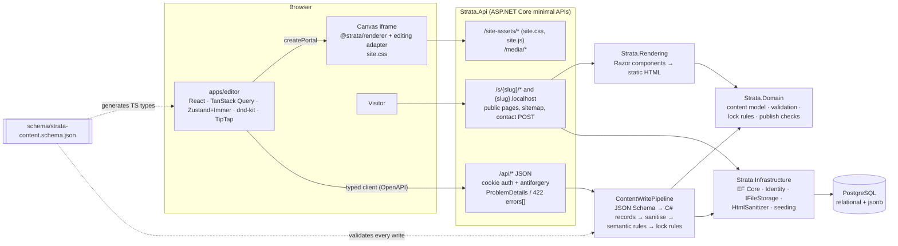

# Strata

A section-based website builder, built as a portfolio project with **.NET 10 + React**.

- **Designers** visually compose reusable **section types** from layout and content primitives.
  They choose which parts site owners may edit and assemble **starter templates** with locked
  brand and compliance content.
- **Site owners** create a site from a template, edit it inline in a drag-and-drop editor, then
  publish it. **Published sites are server-rendered by .NET** from immutable snapshots.

It is an independent implementation of the *concepts* behind section-based marketing-site
platforms for regulated industries (for example financial advisers), with an emphasis on clean
boundaries, strong typing, real tests and documented decisions rather than feature count.
All names, copy and imagery are original; the demo firm is fictional.


## Highlights

- **One content model.** A JSON Schema (`schema/strata-content.schema.json`) defines primitives,
  slots, themes, pages and site documents. TypeScript types are generated from it. Hand-written
  C# records are validated against it on every write, and round-trip tests catch drift.
  ([ADR 0002](docs/adr/0002-json-content-model-and-storage.md))
- **Two renderers, one markup.** React renders the editor canvas and Razor components render
  published pages. Parity fixtures make them produce identical HTML, styled by one hand-written
  stylesheet. ([ADR 0001](docs/adr/0001-dual-renderers-with-parity-tests.md))
- **Locks enforced by the server.** Slot locks, section locks (locked/required), theme-token
  locks and version pins are checked on every write by diffing against the stored draft. Each
  rule has an integration test that tries to bypass it through the API.
  ([ADR 0003](docs/adr/0003-server-authoritative-lock-enforcement.md))
- **Independent copies, pinned versions.** Sites copy a template version. Instances pin immutable
  section versions. Publishing snapshots the draft together with every definition it uses.
  ([ADR 0004](docs/adr/0004-independent-copies-and-pinned-versions.md))
- **A real editor.** The canvas is a same-origin iframe for CSS isolation, with inline
  `contentEditable`/TipTap editing, an overlay for drag-and-drop, undo/redo and debounced
  autosave with optimistic concurrency (ETag/If-Match, 409 handling).
  ([ADR 0005](docs/adr/0005-editor-canvas-iframe-with-overlay.md))
- **Accessibility guardrails.** Publish checks block on empty required slots, missing alt text
  and broken links. They warn on h1 count, skipped heading levels and WCAG AA contrast, and
  each issue links to its section in the editor.
- **Production-minded public hosting.** `/s/{slug}` and `{slug}.localhost`; title/meta/Open
  Graph/canonical; sitemap and robots; styled 404; ETag/304; CSP. The contact form works
  without JavaScript and has server validation, a honeypot and rate limiting. Personal data is
  never logged.

## Architecture



| Path | Contents |
|---|---|
| `src/Strata.Domain` | Content model records, definition rules, document validator, lock rules, publish checks (pure, no infrastructure) |
| `src/Strata.Infrastructure` | EF Core + migrations, Identity, schema validator, sanitiser, file storage, demo seed |
| `src/Strata.Rendering` | Razor components for every primitive, public page document, 404 |
| `src/Strata.Api` | Minimal API feature folders, auth/antiforgery, public site hosting |
| `apps/editor` | Section designer, site/template editor, sites, media, messages |
| `packages/schema` · `renderer` · `site-styles` · `api-client` | Generated content types, React renderer, published CSS/JS, generated OpenAPI client |
| `fixtures/` | Content, parity and contrast fixtures shared by .NET and TypeScript tests |
| `e2e/` | Playwright acceptance tests for every milestone |
| `docs/adr/` | Architecture decision records |

`PLAN.md` describes the architecture in depth and `PROGRESS.md` records what was built,
how each requirement was verified, deviations and known issues.

## Getting started

Requirements: **Docker**, **.NET SDK 10**, **Node 24** with corepack (pnpm). `make` is optional;
every target is a script in `scripts/`.

```bash
make dev        # ./scripts/dev.sh — Postgres in Docker, API with dotnet watch, editor with Vite
```

| URL | What |
|---|---|
| http://localhost:5173 | Editor (proxies the API, so everything is same-origin) |
| http://localhost:5173/s/harbor-pine/ | The published demo site (path routing) |
| http://harbor-pine.localhost:5080/ | The same site on its own host (browsers resolve `*.localhost`) |
| http://localhost:5080/openapi/v1.json | OpenAPI document |

The whole stack in Docker (Postgres, API, nginx serving the editor):

```bash
docker compose up --build -d --wait    # → http://localhost:8080, demo at /s/harbor-pine/ or http://harbor-pine.localhost:8080
```

On first start the database is migrated and seeded (development only).

### Seeded accounts and content

| Role | Email | Password |
|---|---|---|
| Designer | `designer@strata.local` | `Designer!2026` |
| Site owner | `owner@strata.local` | `Owner!2026` |

The seed includes three theme presets, ten section types for the fictional **Harbor & Pine
Wealth Partners** (all built from primitives in the content model), and the starter template
**Harbor & Pine Advisor**. In that template the footer and its regulatory disclosure are
locked, the header and contact section are required, and the brand colours are locked. The
seed also creates the published demo site `harbor-pine`, owned by the site owner. Placeholder
images are drawn at seed time; nothing is downloaded.

## Two-minute reviewer demo

1. **Public site (15 s).** Open http://localhost:5173/s/harbor-pine/. View the page source and
   you'll see server-rendered HTML with SEO and Open Graph tags. Narrow the window to see the
   mobile menu and stacked columns. Try `/s/harbor-pine/sitemap.xml` and a missing page for
   the styled 404.
2. **Edit inline (30 s).** Sign in as the **site owner** → *My sites* → *Harbor & Pine Wealth
   Partners*. Click the hero headline and type. Hover the footer: the disclosure is locked
   (tooltip) and its section toolbar has no delete. Drag *Our process* above *Our philosophy*
   by its handle, then press **Ctrl/Cmd+Z** and **Shift+Ctrl/Cmd+Z**.
3. **Locks in the theme (15 s).** *Theme* tab: Primary and Secondary are locked; change
   Accent. Set Text to a light grey and watch the contrast warning appear, then undo.
4. **Publish guardrails (30 s).** Click the hero image → upload any JPEG/PNG → clear the alt
   text → *Apply*. *Publish* lists the blocking error. Click it to jump to the section, add alt
   text, then publish. *View site* shows the change. Edit again without publishing and the
   public page doesn't change. Send a message with the contact form; it appears under
   *Messages*.
5. **Design a section (30 s).** Sign out and sign in as the **designer** → *Sections* →
   *Team bios*. Select the repeater in the outline (Alt+↑/↓ also moves nodes), switch a slot to
   *Locked*, preview at 375 px, then *Publish version*. *Templates* → *Harbor & Pine Advisor*
   shows the same editor with lock controls.

<p>
  
  
</p>
<p>
  
  
</p>
<p>
  
  
</p>

Screenshots are captured by Playwright from the seeded content (`make screenshots`).

## Tests and quality gates

```bash
make test       # dotnet build (warnings as errors), .NET tests, generated-code staleness, lint, typecheck, unit tests
make e2e        # Playwright acceptance tests against a freshly seeded database (ports 5081/5174)
```

| Suite | What it covers |
|---|---|
| `Strata.Domain.Tests` | Definition rules, document validation, every lock rule, publish checks, contrast vectors |
| `Strata.Infrastructure.Tests` | Schema ↔ C# round trips and discriminator parity, validator error narrowing, sanitiser allowlist, image sniffing (SVG rejected), seed content validity |
| `Strata.Rendering.Tests` | Razor output vs the React snapshots for every parity fixture, normaliser behaviour |
| `Strata.Api.Tests` | Testcontainers Postgres: auth, CRUD, versioning, ownership (404 for other users), lock bypass attempts, uploads, publishing, public pages, contact form, rate limiting, seeding |
| Vitest | React renderer snapshots and adapter contract, schema fixtures (Ajv), editor stores, tree and site operations, contrast |
| Playwright | Milestone acceptance flows M0–M6 (login, section designer, site editor and templates, publishing, seed content) |

CI (`.github/workflows/ci.yml`) runs the same commands.

## Known limitations

- Single-document drafts: concurrent edits to different pages of one site conflict (409 →
  reload). There is no real-time collaboration (out of scope).
- Section instances cannot be upgraded to newer section versions yet. Pins and immutable
  versions are stored so this can be added later. Template changes never propagate to sites,
  by design.
- Drag and drop has no keyboard sensor. The toolbar and outline buttons and shortcuts are the
  keyboard path.
- Repeaters cannot be nested, and there is at most one contact form and one nav per section.
- The contact rate limiter is in-memory (single API instance). Contact messages are stored
  only; no email is sent.
- Public snapshots are cached in process by version id. With several API instances each would
  warm its own cache.
- No custom domains, organisations/multi-tenancy, billing, blogs or AI features (out of scope).
- `make` is not required (and was not available on the development machine); all logic is in
  `scripts/`.

More detail, including deviations from the original brief, is in `PROGRESS.md`.
