<p align="center">
  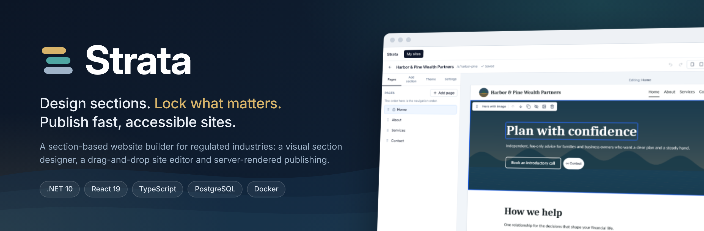
</p>

<p align="center">
  <strong>A section-based website builder with a visual section designer, a drag-and-drop site editor and server-rendered publishing.</strong><br>
  Built with .NET 10 and React 19, with server-enforced brand and compliance locks.
</p>

<p align="center">
  <a href="https://github.com/joecrockett5/strata/actions/workflows/ci.yml"></a>
  <a href="https://github.com/joecrockett5/strata/actions/workflows/codeql.yml"></a>
  <a href="LICENSE"></a>
  <a href="CONTRIBUTING.md"></a>
  <a href="https://www.conventionalcommits.org"></a>
</p>

<p align="center">
  
  
  
  
  
  
  
  
  
</p>

<p align="center">
  <a href="#features">Features</a> ·
  <a href="#screenshots">Screenshots</a> ·
  <a href="#quick-start">Quick start</a> ·
  <a href="#architecture">Architecture</a> ·
  <a href="#testing-and-quality">Testing</a> ·
  <a href="#documentation">Docs</a> ·
  <a href="CONTRIBUTING.md">Contributing</a>
</p>

---

<p align="center">
  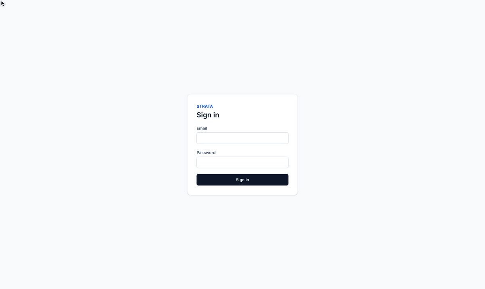
  <br>
  <sub>A site owner edits a headline inline, drags in a section, publishes, and the server-rendered site updates.<br>Recorded with Playwright from the seeded demo (<code>./scripts/demo-gif.sh</code>).</sub>
</p>

## About

Strata is for **marketing sites in regulated industries**, such as financial advisers, where a
firm's brand and compliance text must stay intact while the people who run each site still edit
it themselves.

- **Designers** visually compose reusable **section types** from layout and content
  primitives. They choose which parts site owners may edit and assemble **starter templates**
  with locked brand and compliance content.
- **Site owners** create a site from a template, edit it inline in a drag-and-drop editor and
  publish it.
- **Visitors** get fast, accessible pages that **.NET renders on the server** from immutable
  published snapshots.

The project puts clean boundaries, strong typing, real tests and documented decisions ahead of
feature count. All names, copy and imagery are original, and the demo firm is fictional.

## Features

<table>
  <tr>
    <td width="33%" valign="top">
      <h3>🎨 Section designer</h3>
      Compose sections from primitives (columns, repeaters, headings, rich text, images,
      buttons, nav, contact forms) with a palette, a keyboard-accessible outline tree, a live
      canvas and responsive previews. Every slot is <em>editable</em> or <em>locked</em>, and
      sections are published as immutable versions.
    </td>
    <td width="33%" valign="top">
      <h3>✏️ Site and template editor</h3>
      Inline text and rich-text editing (TipTap) right on the page, drag-and-drop sections,
      pages and navigation, a theme panel with WCAG contrast warnings, a media library,
      undo/redo and debounced autosave with optimistic concurrency.
    </td>
    <td width="33%" valign="top">
      <h3>🔒 Server-enforced locks</h3>
      Slot locks, section locks (locked or required), theme-token locks and version pins are
      checked on every write by diffing against the stored draft. Each rule has an integration
      test that tries to bypass it through the API.
    </td>
  </tr>
  <tr>
    <td width="33%" valign="top">
      <h3>✅ Accessibility guardrails</h3>
      Publishing is blocked by empty required slots, missing alt text and broken links. It
      warns about the number of h1s, skipped heading levels and WCAG AA contrast. Each issue
      links straight to its section in the editor.
    </td>
    <td width="33%" valign="top">
      <h3>🚀 Production-minded hosting</h3>
      <code>/s/{slug}</code> and <code>{slug}.localhost</code> routing, title, meta, Open Graph
      and canonical tags, sitemap and robots, a styled 404, ETag/304 and a CSP. The contact form
      works without JavaScript and has validation, a honeypot and rate limiting.
    </td>
    <td width="33%" valign="top">
      <h3>🧩 One content model, two renderers</h3>
      One JSON Schema drives generated TypeScript types and validated C# records. React renders
      the editor canvas and Razor renders published pages, and parity fixtures keep their HTML
      identical.
    </td>
  </tr>
</table>

## Screenshots

<table>
  <tr>
    <td width="50%">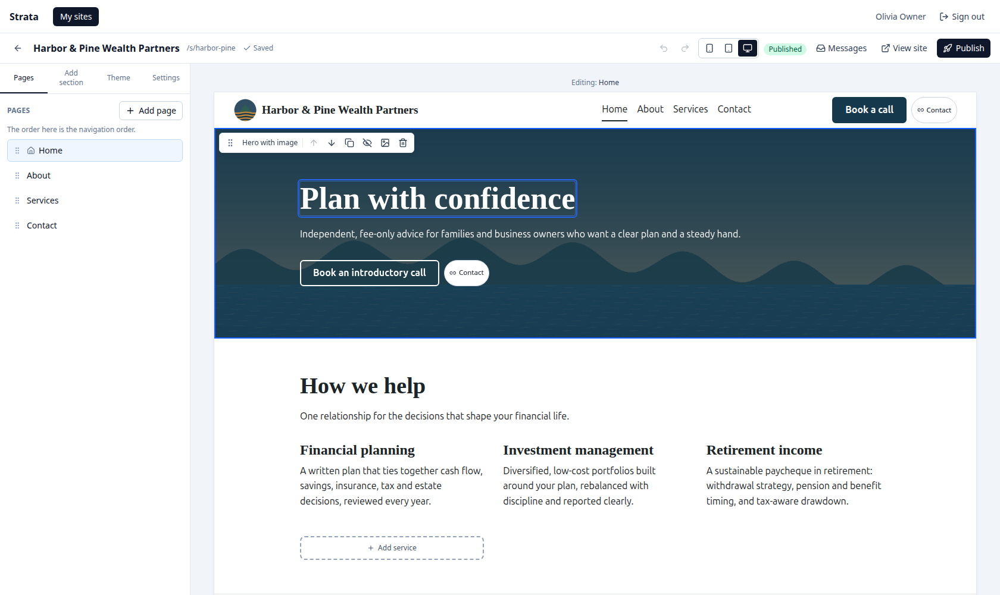</td>
    <td width="50%">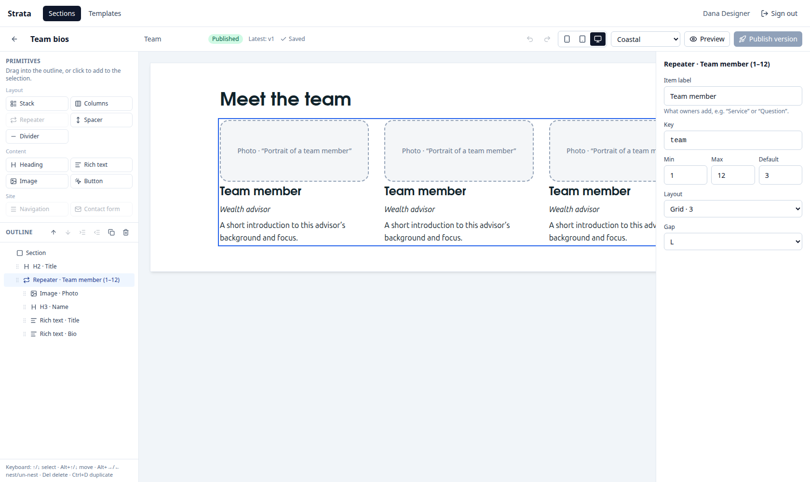</td>
  </tr>
  <tr>
    <td align="center"><b>Site editor</b>: inline editing on the real renderer, section toolbar and pages panel</td>
    <td align="center"><b>Section designer</b>: palette, outline tree, live canvas and properties</td>
  </tr>
  <tr>
    <td>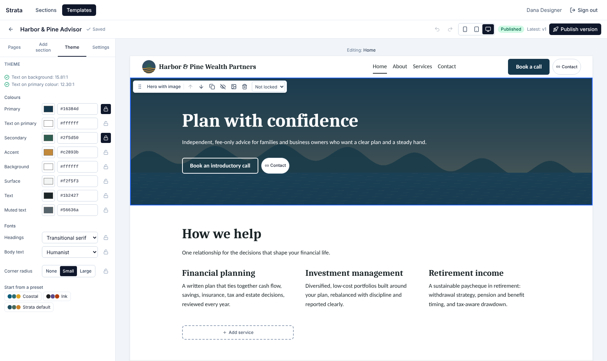</td>
    <td>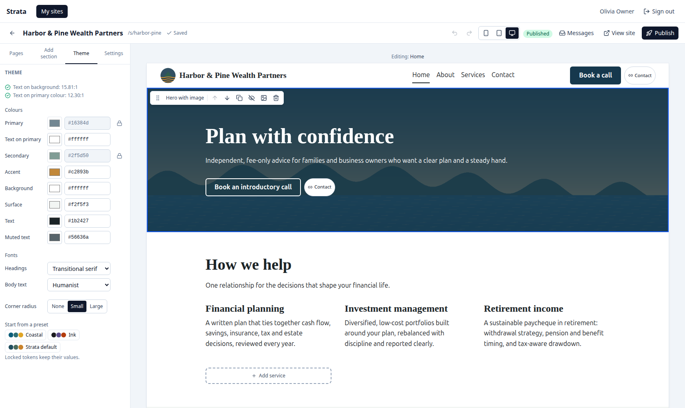</td>
  </tr>
  <tr>
    <td align="center"><b>Template editor</b>: designers lock brand colours and sections for site owners</td>
    <td align="center"><b>Theme for owners</b>: locked tokens are read-only, with live contrast checks</td>
  </tr>
  <tr>
    <td>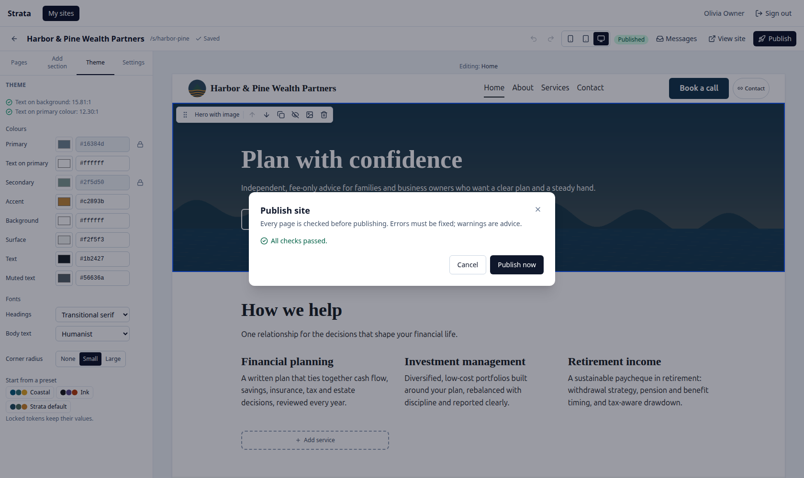</td>
    <td>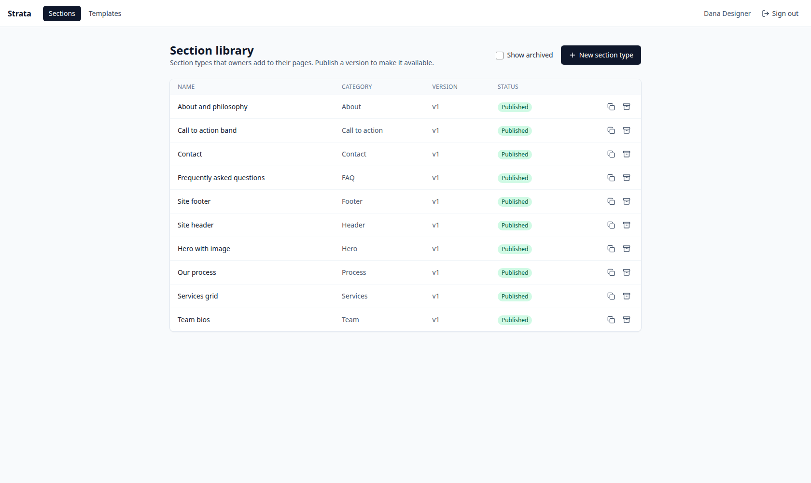</td>
  </tr>
  <tr>
    <td align="center"><b>Publish checks</b>: accessibility and link checks before anything goes live</td>
    <td align="center"><b>Section library</b>: versioned section types with status badges</td>
  </tr>
  <tr>
    <td>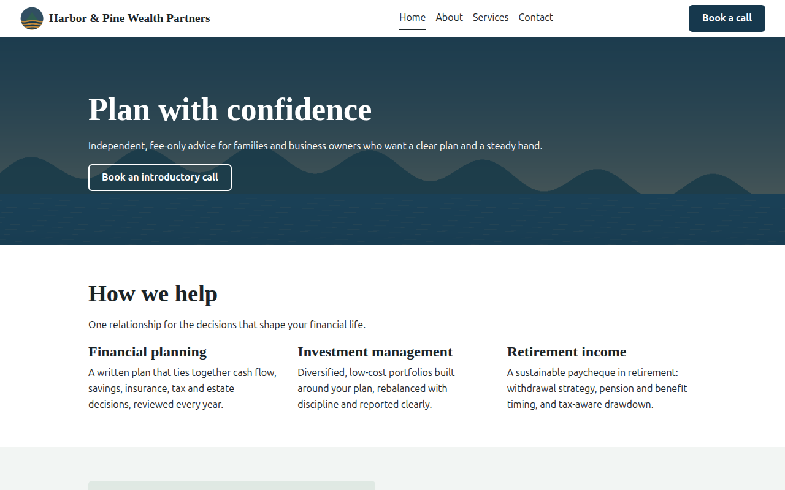</td>
    <td align="center">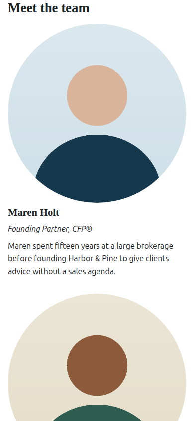</td>
  </tr>
  <tr>
    <td align="center"><b>Published site</b>: server-rendered HTML from an immutable snapshot</td>
    <td align="center"><b>Mobile</b>: the mobile-first site stylesheet on a phone</td>
  </tr>
</table>

<sub>Every image in this README is captured by Playwright from the seeded content
(<code>./scripts/screenshots.sh</code>), so they stay in step with the code.</sub>

## Quick start

### Run everything in Docker

The only requirement is **Docker**.

```bash
git clone https://github.com/joecrockett5/strata.git
cd strata
docker compose up --build -d --wait
```

Open **http://localhost:8080** and sign in with one of the [seeded accounts](#seeded-accounts-and-content).
The published demo site is at http://localhost:8080/s/harbor-pine/ and on its own host at
http://harbor-pine.localhost:8080. The database is migrated and seeded on first start.

### Develop locally

Requirements: **Docker**, the **.NET SDK 10** and **Node 24** with corepack (pnpm). `make` is
optional, because every target is a script in `scripts/`.

```bash
./scripts/dev.sh        # or: make dev. Postgres in Docker, API with dotnet watch, editor with Vite
```

| URL | What |
|---|---|
| http://localhost:5173 | Editor (proxies the API, so everything is same-origin) |
| http://localhost:5173/s/harbor-pine/ | The published demo site (path routing) |
| http://harbor-pine.localhost:5080/ | The same site on its own host (browsers resolve `*.localhost`) |
| http://localhost:5080/openapi/v1.json | OpenAPI document |

### Seeded accounts and content

| Role | Email | Password |
|---|---|---|
| Designer | `designer@strata.local` | `Designer!2026` |
| Site owner | `owner@strata.local` | `Owner!2026` |

> [!NOTE]
> These accounts exist only for local development. Seeding is off by default and only
> `appsettings.Development.json` turns it on.

The seed includes three theme presets, ten section types for the fictional **Harbor & Pine
Wealth Partners** (all built from primitives in the content model), and the starter template
**Harbor & Pine Advisor**. In that template the footer and its regulatory disclosure are
locked, the header and contact section are required, and the brand colours are locked. The
seed also creates the published demo site `harbor-pine`, owned by the site owner. Placeholder
images are drawn at seed time, so nothing is downloaded.

## Two-minute tour

<details open>
<summary><b>Follow these steps to see the main features</b></summary>
<br>

1. **Public site (15 s).** Open http://localhost:5173/s/harbor-pine/. The page source is
   server-rendered HTML with SEO and Open Graph tags. Narrow the window to see the mobile menu
   and stacked columns. Try `/s/harbor-pine/sitemap.xml`, and a missing page for the styled 404.
2. **Edit inline (30 s).** Sign in as the **site owner**, open *My sites* and then *Harbor &
   Pine Wealth Partners*. Click the hero headline and type. Hover over the footer: the
   disclosure is locked (see the tooltip) and its section toolbar has no delete button. Drag
   *Our process* above *Our philosophy* by its handle, then press **Ctrl/Cmd+Z** and
   **Shift+Ctrl/Cmd+Z**.
3. **Locks in the theme (15 s).** On the *Theme* tab, Primary and Secondary are locked. Change
   Accent. Set Text to a light grey and watch the contrast warning appear, then undo.
4. **Publish guardrails (30 s).** Click the hero image, upload any JPEG or PNG, clear the alt
   text and click *Apply*. *Publish* lists the blocking error. Click it to jump to the section,
   add alt text, then publish. *View site* shows the change. Edit again without publishing and
   the public page stays the same. Send a message with the contact form and it appears under
   *Messages*.
5. **Design a section (30 s).** Sign out, sign in as the **designer** and open *Sections* and
   then *Team bios*. Select the repeater in the outline (Alt+↑/↓ also moves nodes), switch a
   slot to *Locked*, preview at 375 px, then click *Publish version*. *Templates* → *Harbor &
   Pine Advisor* shows the same editor with lock controls.

</details>

## Architecture

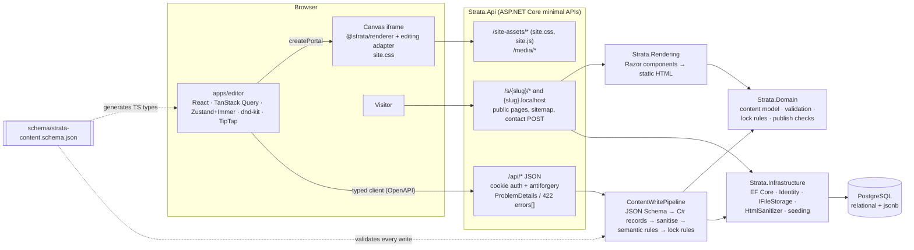

### Key design decisions

| Decision | Why | ADR |
|---|---|---|
| **One content model.** A JSON Schema defines primitives, slots, themes, pages and site documents. TypeScript types are generated from it, and hand-written C# records are validated against it on every write. | One source of truth for the editor and the server. Round-trip tests catch drift. | [0002](docs/adr/0002-json-content-model-and-storage.md) |
| **Two renderers, one markup.** React renders the editor canvas and Razor renders published pages. | Rich editing in the browser and fast, JavaScript-free published pages. Parity fixtures keep the HTML identical, styled by one hand-written stylesheet. | [0001](docs/adr/0001-dual-renderers-with-parity-tests.md) |
| **Locks enforced by the server.** Every write is diffed against the stored draft. | The editor's lock UI is a convenience, not a security boundary. | [0003](docs/adr/0003-server-authoritative-lock-enforcement.md) |
| **Independent copies, pinned versions.** Sites copy a template version, instances pin immutable section versions and publishing snapshots every definition used. | A published site never changes because someone edited a template. | [0004](docs/adr/0004-independent-copies-and-pinned-versions.md) |
| **Editor canvas as a same-origin iframe.** Inline editors run through an adapter and drag-and-drop runs in an overlay. | CSS isolation for the published stylesheet without giving up React portals. | [0005](docs/adr/0005-editor-canvas-iframe-with-overlay.md) |

### Tech stack

| Layer | Technology |
|---|---|
| API | ASP.NET Core 10 minimal APIs, ASP.NET Core Identity (cookie auth + antiforgery), built-in OpenAPI |
| Domain and persistence | C# 14, EF Core 10 with Npgsql (`jsonb`), JsonSchema.Net, HtmlSanitizer |
| Published rendering | Razor components rendered to static HTML, a hand-written mobile-first stylesheet |
| Editor | React 19, Vite 8, TypeScript 5.9 (strict), Tailwind CSS 4, TanStack Query, Zustand + Immer, dnd-kit, TipTap, React Router |
| API client | `openapi-typescript` + `openapi-fetch`, generated from the API's OpenAPI document |
| Testing | xUnit v3, Shouldly, Testcontainers (PostgreSQL), Vitest, Ajv, Playwright |
| Infrastructure | PostgreSQL 17, Docker Compose, nginx, GitHub Actions, CodeQL |

### Project layout

| Path | Contents |
|---|---|
| `src/Strata.Domain` | Content model records, definition rules, document validator, lock rules, publish checks (pure, no infrastructure) |
| `src/Strata.Infrastructure` | EF Core + migrations, Identity, schema validator, sanitiser, file storage, demo seed |
| `src/Strata.Rendering` | Razor components for every primitive, public page document, 404 |
| `src/Strata.Api` | Minimal API feature folders, auth/antiforgery, public site hosting |
| `apps/editor` | Section designer, site/template editor, sites, media, messages |
| `packages/schema` · `renderer` · `site-styles` · `api-client` | Generated content types, React renderer, published CSS/JS, generated OpenAPI client |
| `fixtures/` | Content, parity and contrast fixtures shared by .NET and TypeScript tests |
| `e2e/` | Playwright acceptance tests for every milestone, plus the README screenshot and demo recorders |
| `docs/` | Architecture decision records, screenshots and README media |

## Testing and quality

```bash
./scripts/test.sh       # make test: build (warnings are errors), .NET tests, generated-code staleness, format, lint, typecheck, unit tests
./scripts/e2e.sh        # make e2e: Playwright acceptance tests against a freshly seeded database (ports 5081/5174)
```

| Suite | What it covers |
|---|---|
| `Strata.Domain.Tests` | Definition rules, document validation, every lock rule, publish checks, contrast vectors |
| `Strata.Infrastructure.Tests` | Schema ↔ C# round trips and discriminator parity, validator error narrowing, sanitiser allowlist, image sniffing (SVG rejected), seed content validity |
| `Strata.Rendering.Tests` | Razor output vs the React snapshots for every parity fixture, normaliser behaviour |
| `Strata.Api.Tests` | Testcontainers Postgres: auth, CRUD, versioning, ownership (404 for other users), lock bypass attempts, uploads, publishing, public pages, contact form, rate limiting, seeding |
| Vitest | React renderer snapshots and adapter contract, schema fixtures (Ajv), editor stores, tree and site operations, contrast |
| Playwright | Milestone acceptance flows M0–M6 (login, section designer, site editor and templates, publishing, seed content) |

[CI](.github/workflows/ci.yml) runs the same commands on every push and pull request, and
[CodeQL](.github/workflows/codeql.yml) scans the C#, TypeScript and workflow code.

## Documentation

| Document | What it covers |
|---|---|
| [`PLAN.md`](PLAN.md) | Architecture in depth: layout, data model, API surface, risks |
| [`PROGRESS.md`](PROGRESS.md) | What was built in each milestone, how it was verified, deviations and known issues |
| [`docs/adr/`](docs/adr/README.md) | Architecture decision records |
| [`CHANGELOG.md`](CHANGELOG.md) | Notable changes by milestone |
| [`CONTRIBUTING.md`](CONTRIBUTING.md) | Development setup, checks and conventions |

## Known limitations

- **Single-document drafts.** Concurrent edits to different pages of one site conflict (409,
  then reload). Real-time collaboration is out of scope.
- **No section upgrades yet.** Section instances cannot be upgraded to newer section versions.
  Pins and immutable versions are stored so this can be added later. Template changes never
  reach existing sites, by design.
- **Drag and drop has no keyboard sensor.** The toolbar and outline buttons and keyboard
  shortcuts are the keyboard path.
- **Nesting limits.** Repeaters cannot be nested, and a section has at most one contact form
  and one nav.
- **Single-instance assumptions.** The contact rate limiter and the published-snapshot cache
  live in process memory, so with several API instances each would keep its own. Contact
  messages are stored but no email is sent.
- **Out of scope:** custom domains, organisations and multi-tenancy, billing, blogs and AI
  features.

`PROGRESS.md` has more detail, including deviations from the original brief.

## Contributing

Contributions are welcome. Read the [contributing guide](CONTRIBUTING.md) for setup, checks and
conventions, and follow the [code of conduct](CODE_OF_CONDUCT.md). Report security problems
privately as described in [SECURITY.md](SECURITY.md).

## License

Strata is released under the [MIT License](LICENSE).
